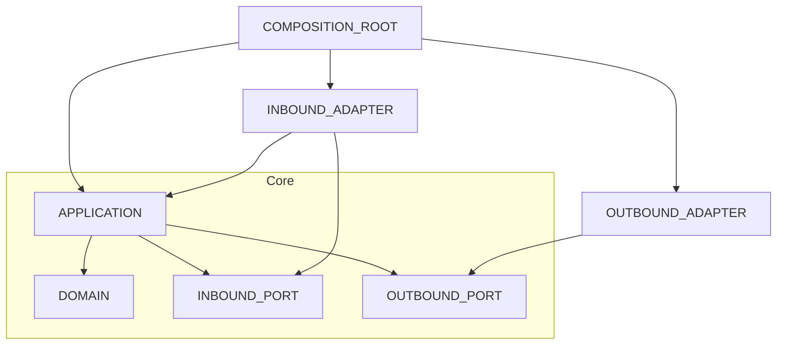

# How ArchGuard works

## The model

ArchGuard reduces any codebase to a graph: **units** (Java classes, TypeScript/JavaScript files, Python modules) connected by **dependencies** (imports, type references, framework signals). The policy assigns units to roles and contexts; rules then decide which dependencies are allowed.

### Roles

Every unit inside `roots` should have exactly one role. Roles are the same in every language and every architecture style.

| Role | Holds | Typical examples |
|---|---|---|
| `DOMAIN` | Business concepts and rules | Entities, value objects, domain services, domain events |
| `APPLICATION` | Use cases that orchestrate the domain | Application services, command handlers |
| `INBOUND_PORT` | Contracts the outside world calls | Use-case interfaces, commands, queries |
| `OUTBOUND_PORT` | Contracts the core needs from the outside | Repository and gateway interfaces |
| `INBOUND_ADAPTER` | Code that drives the application | REST controllers, GraphQL resolvers, CLI commands, message listeners |
| `OUTBOUND_ADAPTER` | Code the application drives | ORM repositories, HTTP clients, message publishers |
| `COMPOSITION_ROOT` | Wiring and startup | `main`, DI configuration, settings, framework bootstrap |

A unit matching no role is **unclassified**. With `requireClassification: true`, that is a `MODEL-001` finding, so new code cannot silently escape the rules. A unit matching two roles is an analysis error.

### Profiles

A profile is a named set of rules. Combine an architecture style with `ddd` when you have bounded contexts.

| Profile | Rules | What it enforces |
|---|---|---|
| `hexagonal` | HEX-001 to HEX-004 | The core (domain, application, ports) never depends on adapters, the composition root or infrastructure APIs; inbound and outbound adapters do not call each other |
| `clean` | hexagonal + CYCLE-001 | The clean-architecture dependency rule plus no package cycles |
| `layered` | LAYER-001, LAYER-002 | Lower layers never depend on higher ones; presentation does not bypass the business layer |
| `ddd` | DDD-001, DDD-002 | Bounded contexts only use each other's exposed packages, and contexts do not form cycles |
| `modular-monolith` | ddd + CYCLE-001 | Modules use only each other's public API, with no cycles at any level |

Framework rules are always on: `FW-001` (an HTTP endpoint outside an inbound adapter) and `FW-002` (an HTTP endpoint exposing a persistence entity in its signature). The full list with rationale and examples is in [Rules](../RULES.md).

### What `hexagonal` forbids

Arrows show allowed directions. Everything pointing from the core outwards is a violation:

| From | Must not depend on | Rule |
|---|---|---|
| `DOMAIN` | application, adapters, composition root, infrastructure APIs (ORM, web framework...) | HEX-001 |
| `APPLICATION` | adapters, composition root | HEX-002 |
| `INBOUND_PORT`, `OUTBOUND_PORT` | adapters, composition root, infrastructure APIs | HEX-003 |
| `INBOUND_ADAPTER` ↔ `OUTBOUND_ADAPTER` | each other | HEX-004 |

The infrastructure API lists per language are in [`spec/infrastructure`](https://github.com/dmishra2022/archguard/blob/main/spec/infrastructure) (for example `org.springframework.`, `sqlalchemy`, `@nestjs/*`).

### Contexts

With `ddd` or `modular-monolith`, each bounded context lists its `packages` and the `exposedPackages` other contexts may use. Reaching into another context's internals is `DDD-001`; a dependency cycle between contexts is `DDD-002`.

## How each analyzer reads code

| | Java | TypeScript / JavaScript | Python |
|---|---|---|---|
| Unit | Class | File | Module (`__init__.py` is the package itself) |
| Selectors match | Packages (`com.acme.orders.domain.**`) | Directories relative to the project root (`src/orders/domain/**`) | Dotted module names under the source root (`orders.domain.**`) |
| Input | Compiled bytecode plus the dependency classpath | Source, through the TypeScript compiler API and your `tsconfig.json` | Source, through the standard `ast` module |
| Dependencies | Every type reference in bytecode, including generics | `import`, `import type`, `export from`, `require`, literal `import()` | `import` and `from ... import` at any level, literal `importlib.import_module` |
| Framework signals | Spring, Quarkus, Micronaut, JAX-RS, CDI, JPA | NestJS, Express, Fastify, Koa, Hono, Next.js, TypeORM, Prisma, Mongoose... | FastAPI, Flask, Django, Django Ninja, SQLAlchemy, Django ORM... |

All three analyzers produce the same findings for the same architecture. They pass a shared [conformance suite](https://github.com/dmishra2022/archguard/blob/main/spec/conformance/README.md) and use the same rule catalog, fingerprints and report formats.

## Gating

- `failOn` (default `ERROR`) sets the lowest severity that fails `check`.
- `newOnly: true` fails only on findings that are not in the baseline. See [Baselines and suppressions](../guides/baselines-and-suppressions.md).
- `--changed-files` reports only findings located in the listed files, but still analyzes the whole project, so a change that breaks a rule against unchanged code is still caught.

Exit codes are the same for every analyzer: `0` pass, `1` policy violation, `2` the analysis could not run (never a pass), `64` usage error.

## Reports

| Format | File | Use |
|---|---|---|
| `console` | stdout | Developers, CI logs |
| `json` | `archguard.json` | Source of truth; dashboards and tooling ([schema](https://github.com/dmishra2022/archguard/blob/main/spec/schemas/findings.schema.json)) |
| `sarif` | `archguard.sarif` | GitHub code scanning and other SARIF viewers |
| `html` | `index.html` | Human review, CI artifacts |
| `agent` | `archguard.agent.jsonl` and stdout | AI coding agents |

## Limits

ArchGuard is static analysis. It does not run your code, so it does not see runtime-only wiring: reflection, dependency-injection decisions made at runtime, string-based plugin loading (for example Django `INSTALLED_APPS`) or imports with computed names. The report's diagnostics list what was skipped, such as computed dynamic imports. Treat code that hides dependencies from the analyzer as a review concern.
