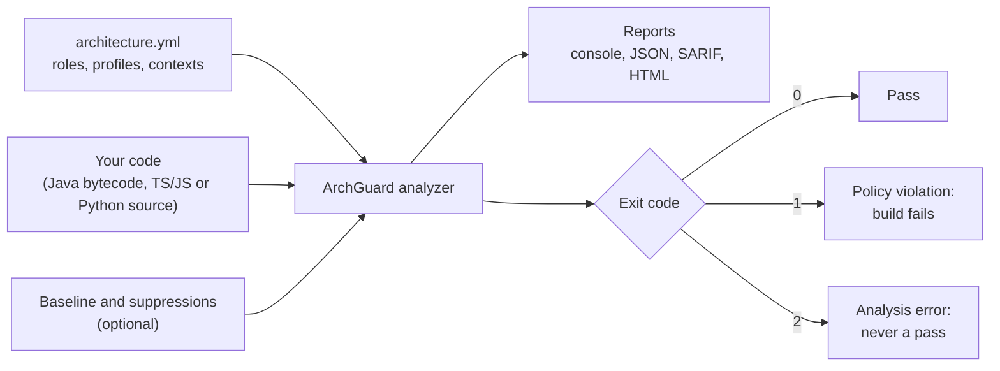

# ArchGuard

ArchGuard checks that a codebase follows its declared architecture, such as hexagonal (ports and adapters), clean, layered, DDD bounded contexts or a modular monolith, and fails the build when a change breaks it. You describe the architecture once in `architecture.yml`; the analyzer reads the code, finds every dependency that crosses a forbidden boundary, and reports the file, line, rule and fix.

It works the same for code written by people and code written by AI coding agents. It never modifies your code and makes no network calls during analysis.

## Why teams adopt it

- **Architecture drift is caught in the pull request**, not in a design review months later. A domain class importing the ORM, a controller calling the database directly, or one bounded context reaching into another's internals fails CI with a precise explanation.
- **One policy model across languages.** Java, TypeScript/JavaScript and Python share the same policy format, rules, report formats and exit codes, so an organisation can set one standard for every service.
- **Adoptable on existing code.** A baseline records today's violations so only new ones fail; the debt can then be paid down gradually.
- **Guardrails for AI coding agents.** An optional agent skill tells agents where code belongs and makes them run the check before handing work back.

## How it works

1. You map each package or directory to a **role** (`DOMAIN`, `APPLICATION`, `INBOUND_PORT`, `OUTBOUND_PORT`, `INBOUND_ADAPTER`, `OUTBOUND_ADAPTER`, `COMPOSITION_ROOT`) and choose one or more **profiles** (`hexagonal`, `clean`, `layered`, `ddd`, `modular-monolith`).
2. The analyzer builds the dependency graph of your code statically.
3. Each profile's rules check every dependency against the roles. A violation names the rule (for example `HEX-002: Application depends on a concrete outer component`), the evidence, and a suggested fix.

Read [How ArchGuard works](concepts/how-it-works.md) for the model in detail.

## Supported languages

| Language | Analyzer | Install | Reads |
|---|---|---|---|
| Java 17+ | Maven plugin or CLI jar (any build tool, Gradle via init script) | `io.archguard:archguard-maven-plugin` | Compiled bytecode |
| TypeScript / JavaScript | `archguard-cli` on npm (Node.js 18+) | `npm install -D archguard-cli` | Source, through the TypeScript compiler API |
| Python 3.9+ | `archguard-cli` on PyPI | `pip install archguard-cli` | Source, through the standard `ast` module |

!!! note "Package availability"
    Until version 0.1.0 is published to PyPI and npm, install the analyzers from a clone of the repository (each quickstart shows how) or from your organisation's internal registry. The packages called `archguard` (PyPI) and `@archguard/cli` (npm) are unrelated projects.

## Where to start

| You are... | Start here |
|---|---|
| A developer trying ArchGuard on a project | The 10-minute quickstart for [Java](getting-started/java.md), [TypeScript](getting-started/typescript.md) or [Python](getting-started/python.md) |
| A tech lead onboarding a team's service | [Onboarding a project](ONBOARDING.md), step by step |
| An architect or engineering manager rolling it out across teams | [Adoption playbook](guides/adoption-playbook.md) and [Organisation presets](guides/org-presets.md) |
| A platform or DevOps engineer | [CI integration](CI.md) |
| A team using AI coding agents | [AI coding agents](guides/ai-agents.md) |
| Stuck | [Troubleshooting](troubleshooting.md), [FAQ](faq.md), [Getting support](support.md) |
