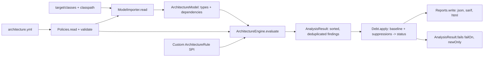

# ArchGuard knowledge base

Curated companion to the generated code graph in `docs/kb/graphify-out/`. The graph gives structure (who calls or references what); this document gives intent (why, invariants, extension points). Keep both in sync: regenerate the graph after code changes and update this file when a responsibility, invariant or contract changes.

## Querying the graph

```bash
uv tool install graphifyy                      # provides the `graphify` CLI
G=docs/kb/graphify-out/graph.json
graphify query "how are findings fingerprinted" --graph $G
graphify explain "BuiltinRules" --graph $G
graphify path "AbstractArchitectureMojo" "Finding" --graph $G
graphify affected "Policy" --graph $G         # what breaks if Policy changes
graphify god-nodes --graph $G
```

Regenerate after code changes (local AST only, no LLM, no API key):

```bash
graphify extract . --code-only --out docs/kb
graphify cluster-only docs/kb --no-label
```

`docs/kb/graphify-out/graph.html` is an interactive view; `GRAPH_REPORT.md` lists hubs and communities. Ignored inputs are listed in `.graphifyignore`.

## What ArchGuard is

Offline, static architecture-conformance analysis for Java. It imports compiled bytecode, classifies classes into declared architectural roles and bounded contexts from `architecture.yml`, evaluates boundary/cycle/framework rules, applies baseline and suppressions, and writes JSON, SARIF and HTML reports. It never modifies source and makes no network or AI calls during analysis.

## Modules and responsibilities

| Module | Responsibility | Must not contain |
|---|---|---|
| `archguard-api` | Immutable records (`ArchitectureModel`, `TypeInfo`, `Dependency`, `Finding`, `Location`, `AnalysisResult`, `Role`, `Severity`) and the `ArchitectureRule` SPI | Maven, framework or ArchUnit types |
| `archguard-core` | Policy decoding/validation (`config`), bytecode import (`engine.ModelImporter`), framework signals (`framework`), rules (`engine.BuiltinRules`, `engine.Cycles`), debt (`engine.Debt`), reports (`report.Reports`) | Maven lifecycle code |
| `archguard-maven-plugin` | Mojos `check`, `analyze`, `check-reactor`, `baseline`, `classpath` (writes the CLI classpath file); reactor and classpath adaptation | Analysis logic |
| `archguard-cli` | Shaded runnable jar: `io.archguard.cli.Main` (commands, exit codes 0/1/2/64), `Inputs` (classes, source roots, classpath files), `ChangedFiles` (scope filter) | Analysis logic |

## Data flow



1. `Policies.read` strictly decodes YAML (duplicate keys, unknown properties, nulls, trailing documents and scalar coercion all fail) and `validate` checks semantics (schemaVersion, known profiles, selector syntax, unique IDs, constraint rationale and remediation).
2. `ModelImporter.read` walks each module's class directory, rejects duplicate class ownership, imports bytecode through ArchUnit with a thread-local `URLClassLoader` (`AnalysisClassResolver`), assigns exactly one role and at most one context per class (overlaps fail), tags framework signals, extracts direct dependencies and HTTP entity exposure edges, and fails on unresolved direct dependencies or empty selectors.
3. `ArchitectureEngine.evaluate` validates rule ID uniqueness (built-in, constraint and SPI), runs `BuiltinRules.evaluate` and custom rules, deduplicates by fingerprint, sorts deterministically and attaches the canonical policy hash.
4. `Debt.apply` marks findings `NEW`, `EXISTING` (in baseline) or `SUPPRESSED` (reviewed suppression with owner, reason, unexpired date).
5. `Reports.write` atomically writes each report file; the Mojo then gates on `failOn` and `newOnly`.

## Built-in rules (where they live)

Detection is in `BuiltinRules.evaluate`, activation in `BuiltinRules.active`. Both are driven by the spec catalog (`io.archguard.spec.SpecCatalog`, which loads `spec/` bundled into the core jar). Role-boundary rules (HEX, LAYER) are evaluated generically from every profile's `roleRules`. Activation comes from the selected profiles (with `includes`) and each rule's `activation` mode. Titles, messages and remediations are catalog templates.

| ID | Trigger | Activation |
|---|---|---|
| HEX-001 | DOMAIN -> APPLICATION/adapters/COMPOSITION_ROOT or infrastructure prefix | `hexagonal` profile |
| HEX-002 | APPLICATION -> adapters/COMPOSITION_ROOT | `hexagonal` profile |
| HEX-003 | ports -> adapters/COMPOSITION_ROOT or infrastructure prefix | `hexagonal` profile |
| HEX-004 | inbound adapter <-> outbound adapter | `hexagonal` profile |
| LAYER-001 | lower layer -> higher layer | `layered` profile |
| LAYER-002 | INBOUND_ADAPTER -> OUTBOUND_ADAPTER | `layered` profile |
| DDD-001 | cross-context access to a non-exposed package | `ddd` profile |
| DDD-002 | cycle among bounded contexts | `ddd` profile |
| CYCLE-001 | cycle among packages | opt-in |
| FW-001 | HTTP endpoint class outside INBOUND_ADAPTER | on |
| FW-002 | endpoint method signature exposes a persistence entity | on |
| MODEL-001 | class under roots has no role | `requireClassification: true` |
| MODEL-002 | framework classification signals (INFO) | on |
| custom | `constraints[]` in policy: `from` packages must not depend on `forbidden` packages | always when declared |

Infrastructure prefixes for HEX-001/003 come from `spec/infrastructure/java.yml`. Framework tags come from `FrameworkClassifier.tags` (Spring, JAX-RS, CDI, JPA javax/jakarta, Panache, Micronaut).

## Invariants (do not break)

- **Analysis errors are never passes.** Invalid policy, missing outputs, unreadable classes, unresolved direct dependencies, empty selectors, rule exceptions, null rule results and rule ID collisions all throw. The Maven adapter writes explicit FAILED reports and raises `MojoExecutionException`, distinct from a policy failure (`MojoFailureException`).
- **Source is read-only.** Nothing writes under source roots.
- **Determinism.** Findings are deduplicated by fingerprint and sorted by rule, module, symbol and fingerprint. Policy hashing is canonical across map and set order.
- **Stable fingerprints.** `sha256(rule \n module \n origin \n target \n evidence-with-(File.java:N)-stripped)`. Line movement does not create new debt.
- **Baselines never grow during checks.** Only the explicit `baseline` goal writes one, and overwriting requires `archguard.overwriteBaseline=true`. Baselines bind to engine version plus policy hash.
- **Suppressions** require a 64-hex fingerprint, owner, reason and an unexpired UTC date. Duplicates fail.
- **Declared roles are authoritative.** Framework signals never remap roles. Overlapping role or context selectors fail.
- **Global goals** (`check-reactor`, `baseline`) must be invoked explicitly after compilation, never lifecycle-bound. Partial reactors require explicit acknowledgement.

## Extension points

- **Custom rules:** implement `io.archguard.api.ArchitectureRule`, register in `META-INF/services/io.archguard.api.ArchitectureRule`, add as a plugin dependency. Use `Finding.create` for stable fingerprints. Rules must be deterministic, read-only and thread-safe.
- **Declarative constraints:** `constraints[]` in `architecture.yml` for forbidden package dependencies with rationale and remediation.
- **Rule overrides:** `rules.<ID>.enabled` / `rules.<ID>.severity`.
- **Internal (not public API):** `FrameworkClassifier`, `ModelImporter`.

## Known limits

Static structural analysis only: no runtime DI, profiles, reflection, synthetic beans, call paths or dataflow. HTTP entity checks cover annotated methods declared on recognized endpoint classes. No incremental cache and no Gradle plugin.

## Agent skill

`skills/archguard/` (install into `.cursor/skills/archguard/`):
- `SKILL.md` gives the workflow: read the policy, map files to roles, place code, run `scripts/check.sh [--changed]`, fix NEW findings, and never edit the policy, baseline or suppressions.
- `reference/rules.md` is generated by `scripts/gen_skill_reference.py`; `spec_check` fails when it is stale.
- `reference/java-placement.md` and `templates/architecture.java.yml` cover placement and onboarding.
- `hooks/` has an optional Cursor `stop` hook.

Contributors working on ArchGuard itself use `.cursor/skills/archguard-dev/SKILL.md`, which points to this KB and the graphify graph.

Verified by dry run on copies of `examples/clean` and `examples/violating`. In `clean`, an agent added an Order lookup with a port method, adapter code and a new application use case, and the check passed. In `violating`, an agent asked to "make the build pass" replaced the concrete adapter dependency with the port and left the policy unchanged.

## Policy loading (schemaVersion 1 and 2)

`Policies.read` resolves `extends` before decoding. Parents may be relative files, `classpath:` resources or `org:<org>/<name>@<version>` (`META-INF/archguard/presets/...` on the analyzer classpath). Maps merge by key, lists of objects merge by `id`, and `locked` rules cannot be changed. Glob selectors are converted to ArchUnit syntax by `Policies.toArchUnit`. `ArchitectureEngine.hash` strips v2-only keys for schemaVersion 1 so 0.1.0 baselines remain valid; `SpecDrivenEngineTest` pins the hash of `examples/clean/architecture.yml`.

## Verified baseline (this branch)

Before the spec refactor, on macOS with OpenJDK 17.0.21 and Maven 3.9.11, `mvn -B clean install` passed 63 unit tests and `scripts/integration_test.py` passed 29 Maven integration scenarios. After the refactor: 86 unit tests (PolicyTest 21, EngineTest 30, ImporterTest 21, SpecDrivenEngineTest 8, SpecParityTest 6), the same 29 integration scenarios, and 8/8 Java conformance cases pass. The CLI adds 12 tests, passes the same 8 conformance cases (`--engine cli`), and produces fingerprints and policy hashes identical to the Maven plugin on the `violating`, `clean`, `spring-boot` and `reactor` examples. All 12 integration reports were compared with pre-refactor reports and are identical in policy hash, fingerprints, messages, evidence, locations and diagnostics; only `specVersion` and `language` were added.

## Standardisation roadmap

See the polyglot standardisation plan: a language-neutral spec in `spec/` (policy schema v2, data-driven profiles, rule catalog, findings contract, conformance suite), a standalone CLI, native Python and TypeScript analyzers, an agent skill in `skills/archguard/`, and a generic CI gate with a GitHub Action.
