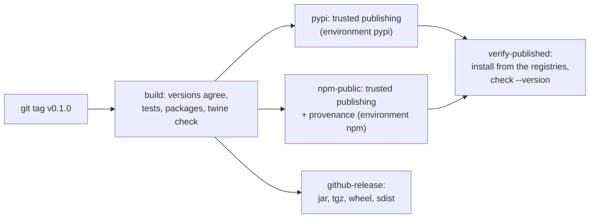

# Releasing to PyPI and npm

This is the plan and runbook for publishing the analyzers as **`archguard-cli`** on [PyPI](https://pypi.org/project/archguard-cli/) and [npm](https://www.npmjs.com/package/archguard-cli). Both names were unclaimed when this was written. Publishing uses **trusted publishing** (OpenID Connect from GitHub Actions): no long-lived registry tokens are stored in the repository, and every release carries a signed provenance attestation that links it to the exact workflow run and commit.

The Java artifacts are released as a jar on GitHub releases and, optionally, to an internal Maven repository. Maven Central is out of scope for this plan (it needs a verified namespace for the `io.archguard` group ID).

## Overview



Everything is in [`.github/workflows/release.yml`](https://github.com/dmishra2022/archguard/blob/main/.github/workflows/release.yml). Nothing is published until the repository variables below are set.

## Phase 1: One-time setup (about one hour)

### Accounts

1. Create (or use) a **PyPI** account and a **TestPyPI** account (they are separate). Turn on two-factor authentication on both; PyPI requires it.
2. Create (or use) an **npm** account. Turn on two-factor authentication for both authorisation and publishing.
3. Optionally create an npm organisation if the package should later be owned by a team rather than a person.

### GitHub environments

In the repository settings, under Environments, create:

| Environment | Protection | Used by |
|---|---|---|
| `pypi` | Required reviewer: a maintainer; deployment branches and tags: `v*` tags only | `pypi` job |
| `npm` | Same as `pypi` | `npm-public` job |
| `testpypi` | None | `testpypi` job (rehearsals) |

The required reviewer means a tag alone cannot publish: a maintainer approves each release in the Actions UI.

### PyPI: pending trusted publishers

PyPI can create the project on first upload from a "pending" publisher, so no manual upload or token is needed.

1. On [pypi.org/manage/account/publishing](https://pypi.org/manage/account/publishing/), add a GitHub publisher:
   - PyPI project name: `archguard-cli`
   - Owner: `dmishra2022`, repository: `archguard`
   - Workflow name: `release.yml`
   - Environment name: `pypi`
2. Repeat on [test.pypi.org/manage/account/publishing](https://test.pypi.org/manage/account/publishing/) with environment `testpypi`.

A pending publisher does not reserve the name; publish soon after creating it.

### npm: first version with a token, then trusted publishing

npm cannot create a new package through trusted publishing; a trusted publisher can only be added to a package that exists. So the first version is published once with a short-lived token:

1. On npmjs.com, create a **granular access token** with read and write permission for packages, an expiry of 7 days, and (because the package does not exist yet) access to all packages.
2. Save it as the repository secret `NPM_TOKEN`.
3. After the first release (Phase 3), open the package settings of `archguard-cli` on npmjs.com, add a **trusted publisher** (GitHub Actions, owner `dmishra2022`, repository `archguard`, workflow `release.yml`, environment `npm`) and allow `npm publish`. Complete a publish with it within 2 days, or the configuration expires.
4. Delete the `NPM_TOKEN` secret and revoke the token. Under the package's publishing access settings, choose to require two-factor authentication and disallow tokens.

### Repository variables

Under Settings, Secrets and variables, Actions, Variables:

| Variable | Value | Effect |
|---|---|---|
| `PYPI_PUBLIC` | `true` | Enables the `pypi` job |
| `NPM_PUBLIC` | `true` | Enables the `npm-public` job |

### Documentation site

Under Settings, Pages, set the source to **GitHub Actions**. The [docs workflow](https://github.com/dmishra2022/archguard/blob/main/.github/workflows/docs.yml) then publishes the site to `https://dmishra2022.github.io/archguard/` on every push to `main`. The package metadata already links to it.

## Phase 2: Rehearsal on TestPyPI and npm dry run

1. Run the release workflow manually from the branch to be released, with **testpypi** checked. This builds, verifies and uploads the Python package to TestPyPI only.
2. Install it in a clean environment and run it against an example:

   ```bash
   python3 -m venv /tmp/ag && . /tmp/ag/bin/activate
   pip install --index-url https://test.pypi.org/simple/ --extra-index-url https://pypi.org/simple/ archguard-cli
   archguard --version
   cd examples/python-violating && archguard check --format console     # expect exit 1
   ```

3. Check the TestPyPI project page: the README renders, the links work, the classifiers are right.
4. For npm, inspect the exact tarball the release builds: download `release-artifacts` from the workflow run and run `npm publish --dry-run archguard-cli-0.1.0.tgz`, then `npm install -g ./archguard-cli-0.1.0.tgz && archguard --version`.

TestPyPI versions cannot be re-uploaded; for a second rehearsal of the same version, use a pre-release version such as `0.1.0rc1` on a throwaway branch.

## Phase 3: First release (0.1.0)

1. Merge the release branch into `main` and make sure all workflows are green.
2. Update `CHANGELOG.md`: move "Unreleased" entries under the version.
3. Check that versions agree everywhere: `python3 scripts/release_check.py v0.1.0`.
4. Tag and push:

   ```bash
   git tag -a v0.1.0 -m "ArchGuard 0.1.0"
   git push origin v0.1.0
   ```

5. Approve the `pypi` and `npm` deployments in the Actions run.
6. Wait for `verify-published`, which installs both packages from the public registries and checks `archguard --version`.
7. Check the GitHub release, the PyPI page (with its attestations) and the npm page (with its provenance badge).
8. Configure npm trusted publishing and remove the token (Phase 1, npm steps 3 and 4).
9. Remove the "Package availability" notes from the docs (home page and quickstarts).

## Phase 4: Every later release

1. Bump the version in every package; `scripts/release_check.py` lists all of them and fails if any disagree.
2. Update `CHANGELOG.md`. Call out anything that changes findings, because it requires consumers to regenerate baselines ([versioning](../reference/compatibility.md)).
3. Tag `v<version>`, approve the deployments, confirm `verify-published`.

Never delete or overwrite a published version. If a release is broken, **yank** it on PyPI and **deprecate** it on npm (`npm deprecate archguard-cli@0.1.1 "broken, use 0.1.2"`), then release a fixed version. `npm unpublish` is only allowed within 72 hours and breaks anyone who already installed it; avoid it.

## Security checklist

- [ ] Two-factor authentication on PyPI, TestPyPI and npm accounts of every maintainer
- [ ] At least two maintainers (owners) on the PyPI project and the npm package, so access is not lost
- [ ] `pypi` and `npm` environments restricted to `v*` tags with a required reviewer
- [ ] No registry tokens in repository secrets after the first npm release
- [ ] npm package set to require two-factor authentication and disallow tokens
- [ ] Private vulnerability reporting turned on (Settings, Code security), as referenced by `SECURITY.md`
- [ ] Dependabot alerts on for the npm and Python dependencies

## Internal registries

Organisations that mirror packages internally can publish the same artifacts with tokens instead: set `MAVEN_REPOSITORY_URL`, `NPM_REGISTRY_URL` or `PYPI_REPOSITORY_URL` with the matching secrets (listed at the top of `release.yml`). These jobs run independently of the public ones.
